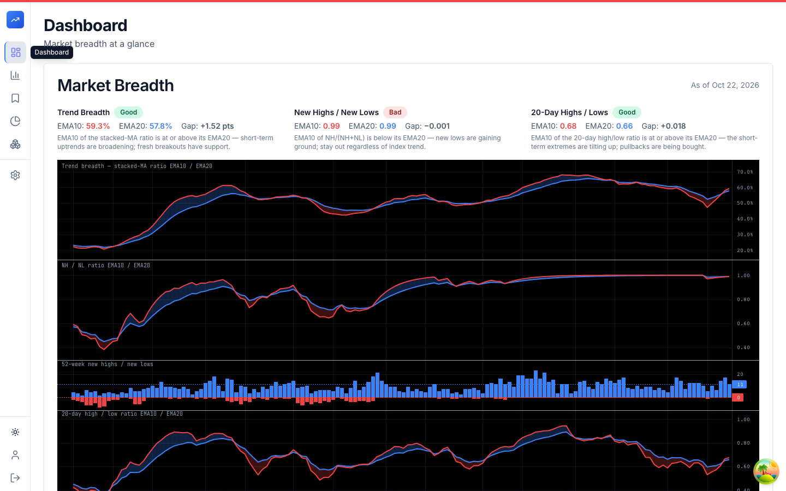
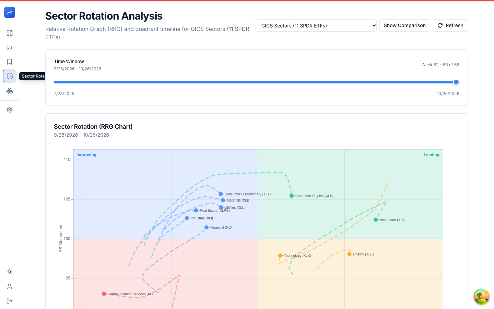
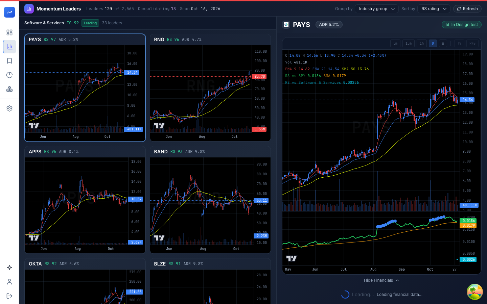
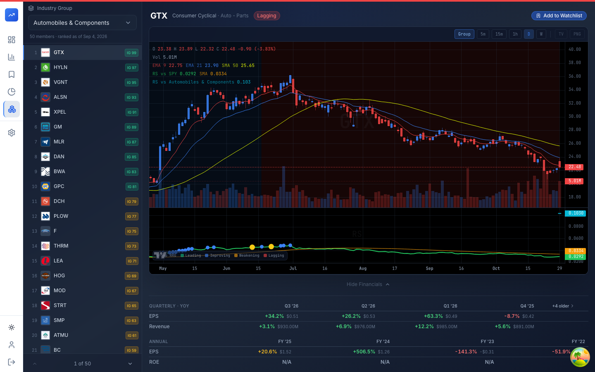
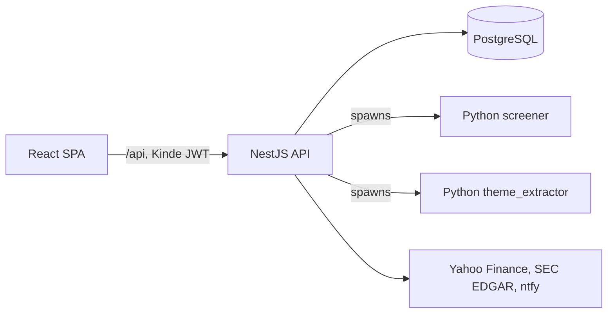

# Blue Star

Blue Star is a personal trading platform for top-down swing trading. It tracks market breadth, sector rotation, industry-group strength and momentum leaders, keeps watchlists with intraday alerts, and shows fundamentals next to the chart.

Every feature serves one workflow: decide whether the market is tradeable, find the leading sectors, find strong stocks consolidating inside them, and enter on the breakout.

|                                                            |                                                          |
| ---------------------------------------------------------- | -------------------------------------------------------- |
|      |  |
|  |  |

## The strategy it serves

1. **Market direction.** Trade only when the market is healthy. Market breadth and a market-health status (good, warning, bad) gate new entries.
2. **Sector leadership.** Apply a Relative Rotation Graph (RRG) to sector ETFs and industry groups to find the leaders.
3. **Stock selection.** Within leading groups, find stocks consolidating after a strong uptrend, ranked by RS rating.
4. **Entry.** Wait for the breakout from the consolidation.

Risk rules used alongside it: size so a stop-out costs a fixed 0.5% of the portfolio, place stops at the chart structure, take a third off at 1:3 reward-to-risk and trail the rest with EMA10 or EMA20. Position tracking was removed from the app (migration `20260902041157-drop-positions-tables`), so these rules are not enforced by the software.

## Features

| Page            | Route              | What it does                                                                                                                                                                 |
| --------------- | ------------------ | ---------------------------------------------------------------------------------------------------------------------------------------------------------------------------- |
| Dashboard       | `/dashboard`       | Market breadth: Trend Breadth (stacked moving averages), 52-week new highs/new lows and 20-day highs/lows, each reduced to a Good or Bad reading from its EMA10 versus EMA20 |
| Sector Rotation | `/sector-rotation` | RRG chart and quadrant timeline (Leading, Weakening, Lagging, Improving) for the 11 GICS sector ETFs and other universes, with a time-window slider and comparison mode      |
| Industry Groups | `/industry-groups` | Pick an industry group and see its members ranked by RS rating, with chart, RS lines and quarterly/annual financials                                                         |
| Stock Analysis  | `/stock-analysis`  | Momentum Leaders: leaders (RS rating) grouped by industry group, with consolidation detection, ADR and chart grid                                                            |
| Watchlists      | `/watchlists`      | Named watchlists with per-list intraday alerts (the gap scan runs every 5 minutes on weekdays)                                                                               |
| Chart Sandbox   | `/chart-sandbox`   | Chart playground on the shared TradingView lightweight-charts component                                                                                                      |

Behind the pages, the backend also provides:

- **Market health.** A computed GOOD/WARNING/BAD status shown as a bar across the app.
- **Leader scan.** A weekly scan of the universe for RS leaders (`/api/leader-scan/latest`).
- **Themes.** Investment themes extracted from stocktitan.net by the Python `theme_extractor` and mapped to tickers.
- **Stock classification.** Sector and industry-group classification per symbol, fetched on demand.
- **Fundamentals.** Quarterly and annual EPS, revenue and ROE from SEC EDGAR; Financial Modeling Prep supplies company profiles.
- **Notifications.** Push alerts (startup, cron results, watchlist gaps) through ntfy.

Most analyses run as weekday or weekly cron jobs (see the `*-cron.service.ts` files under `apps/backend/src/modules`). Authentication is Kinde (JWT) with a global guard; routes marked `@Public()` are open.

## Architecture



- **Monorepo.** Turborepo and npm workspaces: `apps/backend`, `apps/frontend`, `apps/screener`, `apps/theme_extractor`.
- **Backend.** NestJS with DDD and CQRS under `apps/backend/src/modules`. Each module is a bounded context with its own domain model, persistence and public barrel (`index.ts`). Modules talk to each other only through use cases or queries, never through another module's repositories or tables. Domain code throws `DomainError` subclasses, mapped to HTTP once at the exception filter. Modules: `auth`, `fundamental`, `leader-scan`, `market-breadth`, `market-data`, `market-health`, `notification`, `sector-rotation`, `stock-analysis`, `stock-classification`, `themes`, `watchlist`, `watchlist-monitoring`.
- **Frontend.** React 19, Vite, Tailwind CSS, React Query. `src/global/` holds auth, routing and the design system; each domain folder (`watchlist`, `sector-rotation`, `stock-analysis`, ...) has `api/`, `components/`, `hooks/`, `pages/`. Domain folders do not import each other.
- **Python.** `apps/screener` (consolidation, momentum leaders, RS ratings, Yahoo Finance data) and `apps/theme_extractor` are CLIs spawned by the backend. Virtualenvs are created by `npm run setup:python --workspace=backend`, which `dev`, `build` and `start` run automatically.
- **Database.** PostgreSQL with `db-migrate`; SQL migrations live in `apps/backend/migrations/sqls/`, UUID primary keys.
- **Deployment.** `docker-compose.prod.yml` runs the backend (port 3000) and an nginx-served frontend (port 5173) on a Raspberry Pi. PostgreSQL is managed separately by Ansible. CI is in `.github/workflows/ci.yml`.

The strategic rules are in [docs/architecture.md](docs/architecture.md) and the standing decisions in [docs/decisions.md](docs/decisions.md).

## Core concepts

- **RS rating.** A stock's relative strength against the market, used to rank leaders; the same rating is computed per industry group.
- **RRG.** Relative Rotation Graph: RS-ratio against RS-momentum, placing each sector in Leading, Weakening, Lagging or Improving. The algorithm is described in `apps/backend/src/modules/sector-rotation/SECTOR_ROTATION_ALGORITHM.md`.
- **Industry group.** The grouping between sector and stock; groups are rated and ranked like stocks.
- **Consolidation.** A tight range after a strong prior uptrend; the setup the screener looks for before a breakout.
- **Breadth gate.** Each breadth series is a formula over the RS-rating universe, reduced to Good when its EMA10 is at or above its EMA20, otherwise Bad.
- **Bounded context.** A backend module owns its value objects and tables; a downstream module may import the owner's public types.

## Getting started

Prerequisites: Node.js 24 or later (`.tool-versions` pins 24.22.1), npm, Python 3 (for the screeners) and Docker (local PostgreSQL).

```bash
npm ci
cp apps/backend/.env.example apps/backend/.env
cp apps/frontend/.env.example apps/frontend/.env
npm run db:up --workspace=backend
npm run dev
```

`npm run dev` applies migrations to the local Postgres container, then runs the backend (http://localhost:3000, prefix `/api`) and the frontend (http://localhost:5173). `npm run dev:backend` and `npm run dev:frontend` start one app each and do not touch the database. Stop Postgres with `npm run db:down --workspace=backend`.

A fresh database has no data: the analyses are produced by the cron jobs, so most pages stay empty until they have run. Set `CRON_ENABLED=false` or `NOTIFICATIONS_ENABLED=false` to turn the scheduled jobs or push notifications off.

### Environment variables

Names only; see `apps/backend/.env.example`, `apps/frontend/.env.example` and `.env.production.example`.

| Scope                    | Variables                                                                          |
| ------------------------ | ---------------------------------------------------------------------------------- |
| Backend database         | `DB_HOST`, `DB_PORT`, `DB_USERNAME`, `DB_PASSWORD`, `DB_DATABASE`, `DB_SSL`        |
| Backend data providers   | `FINANCIAL_MODELING_PREP_API_KEY`, `SEC_EDGAR_CONTACT_EMAIL`                       |
| Backend notifications    | `NTFY_API_KEY`, `NTFY_BASE_URL`, `NOTIFICATIONS_ENABLED`                           |
| Backend auth and serving | `KINDE_DOMAIN`, `KINDE_CLIENT_ID`, `PORT`, `FRONTEND_URL`, `CRON_ENABLED`          |
| Frontend                 | `VITE_API_URL`, `VITE_KINDE_CLIENT_ID`, `VITE_KINDE_DOMAIN`, `VITE_KINDE_AUDIENCE` |

The app needs a Kinde tenant to sign in: the frontend callback and logout URLs must list the frontend origin (`http://localhost:5173` in dev). `DB_HOST` must stay `localhost` in dev because migrations run on every backend boot.

## Development

```bash
npm run lint
npm run check-types
npm run test
npm run build

cd apps/backend
npx jest src/path/to/file.spec.ts            # single test file
npx jest --config ./test/jest-e2e.json       # e2e
npx jest --testPathPattern integration       # needs Docker (TestContainers)
npm run migrate:create -- my-migration --sql-file
npm run migrate:up
```

The frontend is type-checked with `npx tsc -b` from `apps/frontend`.

## Project layout

```
apps/
  backend/            NestJS API (src/modules, migrations/sqls)
  frontend/           React 19 + Vite SPA (src/global, src/<domain>)
  screener/           Python CLI: consolidation, momentum leaders, RS ratings
  theme_extractor/    Python CLI: investment themes from stocktitan.net
docs/                 architecture.md, decisions.md, screenshots/
docker-compose.prod.yml   production stack (Raspberry Pi)
turbo.json            Turborepo pipeline
```
